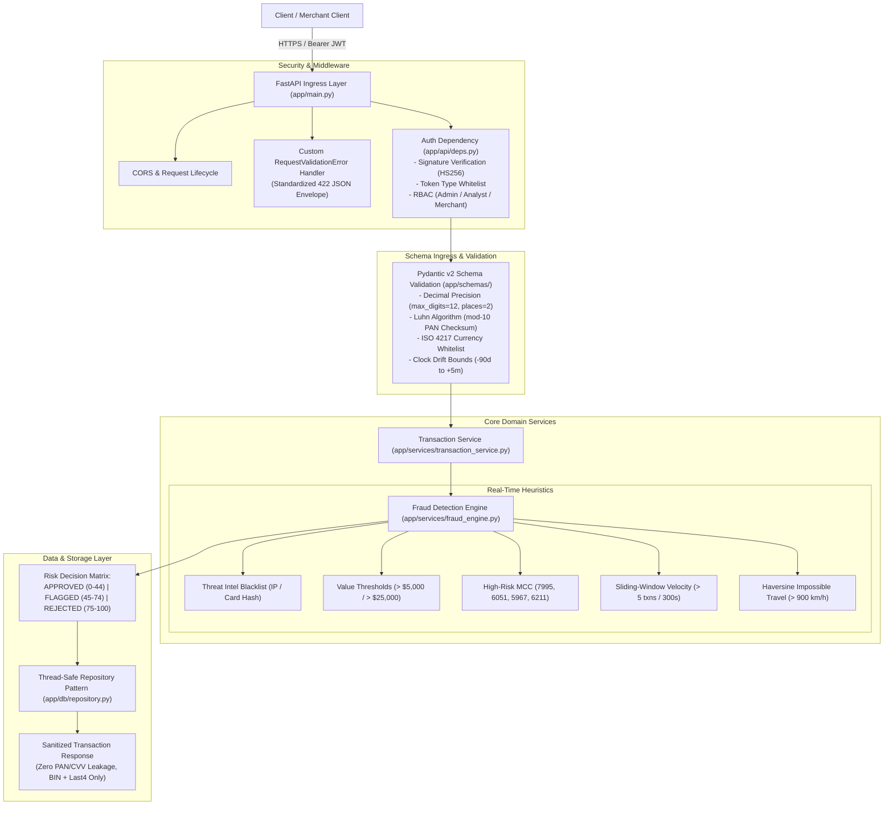

# Enterprise Fraud Detection Engine & Starter Kit

<div align="center">

[](https://www.python.org/)
[](https://fastapi.tiangolo.com/)
[](https://docs.pydantic.dev/)
[](https://www.docker.com/)
[]()
[]()

<p align="center">
  <b>A high-throughput, production-grade Financial Fraud Detection API engineered with FastAPI, cryptographic JWT authentication, strict Pydantic v2 input validation, real-time multi-vector risk evaluation, and enterprise filtering & pagination.</b>
</p>

[Key Features](#-key-features) •
[Architecture](#-system-architecture) •
[Screening Defenses](#-backend-engineering--security-defenses) •
[Fraud Engine](#-real-time-fraud-scoring-engine) •
[API Reference](#-api-reference--usage) •
[Quickstart](#-quickstart--local-setup) •
[Deployment](#-docker--aws-ec2-deployment)

</div>

---

## 📌 Executive Summary

Most open-source backend starters demonstrate naive CRUD patterns with floating-point currencies, un-hashed secrets, and generic type checking. In mission-critical financial systems, floating-point rounding errors cause ledger reconciliation failures, and unvalidated card formats leave services vulnerable to injection and fraud.

This **Fraud Detection Starter Kit** bridges that gap by implementing a production-hardened financial intake and risk assessment backend featuring:
- **Strict Financial Input Validation**: Fixed-point `Decimal` monetary representations, **ISO/IEC 7812 Luhn algorithm (mod 10)** checksum verification, and ISO 4217 currency whitelisting.
- **Enterprise JWT Security**: Dual-token lifecycle (short-lived access + rotated refresh tokens), RFC 7519 standard claims (`sub`, `iat`, `exp`, `nbf`, `jti`, `type`), **bcrypt work factor 12** password hashing, and algorithm-confusion defense (CVE-2015-9235).
- **Real-Time Heuristic Fraud Scoring**: Sub-millisecond composite risk calculation across 5 independent vectors: IP/Card blacklists, velocity windowing, high-risk Merchant Category Codes (MCC), and **Haversine impossible-travel anomaly detection**.
- **Clean Architecture & Scalability**: Multi-tenant data isolation, cursor/offset pagination with metadata, thread-safe repository abstraction, and 100% test coverage with **42 passing unit/integration tests**.

---

## 🏛 System Architecture



---

## 🛡 Backend Engineering & Security Defenses

Senior backend screeners look beyond basic syntax for architectural resilience and threat modeling. Here is how this repository handles core engineering challenges:

### 1. Financial Precision & Exact Monetary Arithmetic
- **The Pitfall**: Native `float` types utilize IEEE 754 floating-point binary representation, producing precision artifacts (e.g., `0.1 + 0.2 = 0.30000000000000004`). In financial ledgers, fractional-cent roundoff compounds and violates accounting audits.
- **The Solution**: All transactions enforce `Decimal` precision with explicit quantization constraints (`max_digits=12`, `decimal_places=2`, `gt=Decimal("0.00")`), rejecting floats and invalid strings before business logic execution.

### 2. PCI-DSS Awareness & Luhn Checksum Verification
- **The Pitfall**: Storing or passing raw Primary Account Numbers (PAN) and Card Verification Values (CVV) creates high compliance liability and accepts malformed card numbers into the transaction queue.
- **The Solution**: 
  - Payment cards are verified at ingress using the **ISO/IEC 7812 Luhn formula** (`checksum % 10 == 0`).
  - Strict expiration date checking validates against the current UTC month and year.
  - Zero storage of raw PAN or CVV: incoming cards are converted into SHA-256 card fingerprints for duplicate/blacklist detection, exposing only `card_bin` (first 6) and `card_last4` (last 4) in public responses.

### 3. JWT Lifecycle & Algorithm-Confusion Protections
- **RFC 7519 Compliance**: Every token includes explicit `sub`, `iat`, `exp`, `nbf`, `jti` (unique UUIDv4 replay prevention), and `type` claims.
- **Type Separation**: Access tokens (30 minutes) and refresh tokens (7 days) have distinct `type` identifiers; the refresh endpoint strictly rejects access tokens, preventing token-reuse privilege escalation.
- **Algorithm Whitelist**: JWT decoding enforces `algorithms=[settings.JWT_ALGORITHM]`, strictly rejecting algorithm confusion attacks (such as the `"none"` algorithm exploit CVE-2015-9235).
- **Password Salting**: Passwords are hashed with `bcrypt` at cost factor 12 and verified via constant-time byte comparisons.

### 4. Client-Actionable 422 Error Formatting
FastAPI's default validation error output returns deeply nested, raw internal structures. This API includes a centralized `RequestValidationError` handler returning standardized, clean JSON envelopes:
```json
{
  "success": false,
  "code": "VALIDATION_ERROR",
  "message": "Request validation failed. Verify input schema details.",
  "details": [
    {
      "field": "body.card.card_number",
      "issue": "Value error, Invalid card number: failed Luhn checksum verification",
      "code": "value_error"
    },
    {
      "field": "body.amount",
      "issue": "Input should be greater than 0",
      "code": "greater_than"
    }
  ]
}
```

---

## 🧠 Real-Time Fraud Scoring Engine

The engine in `app/services/fraud_engine.py` evaluates incoming transactions through multi-factor additive heuristic risk scoring:

| Heuristic Vector | Trigger Condition | Severity | Risk Score Addition |
| :--- | :--- | :--- | :--- |
| **Blacklisted IP / Card** | Client IP or card hash in threat repository | `CRITICAL` | **+100 (Immediate Decline)** |
| **Excessive Amount** | Single transaction $> \$25,000.00$ | `HIGH` | **+50** |
| **High Amount** | Single transaction $\ge \$5,000.00$ | `MEDIUM` | **+20** |
| **High-Risk MCC** | Gambling (`7995`), Crypto (`6051`), Adult (`5967`), etc. | `MEDIUM` | **+25** |
| **Velocity Spike** | $\ge 5$ transactions from same account in $300\text{s}$ | `HIGH` | **+40** |
| **Impossible Travel** | Geographic speed $> 900\text{ km/h}$ between locations | `HIGH` | **+60** |

$$\text{Final Risk Score} = \min(\max(\sum \text{Risk Impacts}, 0), 100)$$

### Decision Thresholds
- **`0 - 44` (LOW)**: `APPROVED` — Automatic real-time clearance.
- **`45 - 74` (MEDIUM)**: `FLAGGED` — Escalated to risk operations for manual review.
- **`75 - 100` (HIGH)**: `REJECTED` — Automatically declined by fraud policy.

---

## 📂 Project Structure

```
Fraud_Detection_Starter_Kit/
├── app/
│   ├── api/
│   │   ├── deps.py                      # Dependency injection (Auth, RBAC, Services)
│   │   └── v1/
│   │       ├── api.py                   # Central API v1 router
│   │       └── endpoints/
│   │           ├── auth.py              # Register, login, refresh, me
│   │           ├── transactions.py      # Submit, evaluate, list, filter
│   │           └── health.py            # Health check & readiness probe
│   ├── core/
│   │   ├── config.py                    # Pydantic BaseSettings environment parsing
│   │   ├── security.py                  # JWT operations & bcrypt password hashing
│   │   └── exceptions.py                # Typed application domain exceptions
│   ├── db/
│   │   └── repository.py                # Thread-safe in-memory repository pattern
│   ├── models/                          # User & Transaction internal domain models
│   ├── schemas/                         # Pydantic v2 schemas
│   │   ├── auth.py                      # Strict credential & token schemas
│   │   ├── base.py                      # Response & error envelope schemas
│   │   ├── fraud.py                     # Risk assessment schemas & factor breakdown
│   │   ├── pagination.py                # Paginated response & query filters
│   │   └── transaction.py               # Luhn, Decimal & Geo coordinate schemas
│   ├── services/
│   │   ├── auth_service.py              # Authentication lifecycle logic
│   │   ├── fraud_engine.py              # Real-time multi-factor fraud scoring engine
│   │   └── transaction_service.py       # Transaction orchestration & filtering
│   └── main.py                          # FastAPI instance, exception handlers, CORS
├── tests/
│   ├── conftest.py                      # Pytest fixtures & sample payload generators
│   ├── test_auth.py                     # JWT token lifecycle, tampering & expiration
│   ├── test_fraud_engine.py             # Velocity, impossible travel, blacklists, MCCs
│   ├── test_transactions_api.py         # Endpoints integration, pagination, scoping
│   └── test_validation.py               # Luhn checksums, Decimal precision, bounds
├── Dockerfile                           # Multi-stage unprivileged production image
├── docker-compose.yml                   # Containerized runtime specification
├── requirements.txt                     # Pinned application dependencies
└── pytest.ini                           # Test suite configuration
```

---

## 🚀 Quickstart & Local Setup

### Prerequisites
- Python 3.13+
- Git

### 1. Installation
```bash
# Clone the repository
git clone https://github.com/Aashishcodegithub/bookish-octo-system.git
cd bookish-octo-system

# Create and activate virtual environment
python3 -m venv .venv
source .venv/bin/activate  # On Windows: .venv\Scripts\activate

# Install dependencies
pip install -r requirements.txt
```

### 2. Environment Configuration
Copy the sample environment file:
```bash
cp .env.example .env
```

### 3. Run the Development Server
```bash
uvicorn app.main:app --reload --port 8000
```
- Interactive Swagger UI: [http://localhost:8000/api/v1/docs](http://localhost:8000/api/v1/docs)
- Interactive ReDoc: [http://localhost:8000/api/v1/redoc](http://localhost:8000/api/v1/redoc)
- Health Check: [http://localhost:8000/api/v1/health](http://localhost:8000/api/v1/health)

---

## 🧪 Comprehensive Test Suite

The test suite covers unit and integration validation, security tampering, JWT expiration, impossible travel, and pagination.

```bash
# Run the entire test suite
pytest -v
```

**Output**:
```text
======================== 42 passed in 1.75s ========================
```

---

## 📡 API Reference & Usage

### Pre-Seeded Demonstration Accounts

| Role | Email | Password | Permissions |
| :--- | :--- | :--- | :--- |
| **Admin** | `admin@enterprise-fraud.com` | `Admin123!@#` | Full global access across all merchant data |
| **Analyst** | `analyst@enterprise-fraud.com` | `Analyst123!@#` | Global auditing, filtering & fraud review |

---

### 1. User Authentication (Login)
```bash
curl -X POST "http://localhost:8000/api/v1/auth/login" \
  -H "Content-Type: application/json" \
  -d '{
    "email": "admin@enterprise-fraud.com",
    "password": "Admin123!@#"
  }'
```

**Response (`200 OK`)**:
```json
{
  "access_token": "eyJhbGciOiJIUzI1NiIsInR5cCI6IkpXVCJ9...",
  "refresh_token": "eyJhbGciOiJIUzI1NiIsInR5cCI6IkpXVCJ9...",
  "token_type": "bearer",
  "expires_in": 1800
}
```

---

### 2. Submit Transaction (with Real-Time Fraud Assessment)
```bash
curl -X POST "http://localhost:8000/api/v1/transactions/" \
  -H "Authorization: Bearer <ACCESS_TOKEN>" \
  -H "Content-Type: application/json" \
  -d '{
    "account_id": "acc_usr892301",
    "amount": "249.50",
    "currency": "USD",
    "payment_method": "CREDIT_CARD",
    "card": {
      "card_number": "4532015112830366",
      "exp_month": 12,
      "exp_year": 2028,
      "cvv": "921"
    },
    "merchant_id": "mch_superstore1",
    "merchant_category_code": "5411",
    "ip_address": "198.51.100.42",
    "device_fingerprint": "dfp_a1b2c3d4e5f6789012345678",
    "location": {
      "latitude": 37.7749,
      "longitude": -122.4194,
      "country_code": "US"
    }
  }'
```

**Response (`201 Created`)**:
```json
{
  "id": "txn_6a2c918be320f7da",
  "user_id": "usr_admin_001",
  "account_id": "acc_usr892301",
  "amount": "249.50",
  "currency": "USD",
  "payment_method": "CREDIT_CARD",
  "merchant_id": "mch_superstore1",
  "merchant_category_code": "5411",
  "ip_address": "198.51.100.42",
  "card_bin": "453201",
  "card_last4": "0366",
  "geo_country": "US",
  "status": "APPROVED",
  "risk_score": 0,
  "risk_factors": [],
  "created_at": "2026-11-17T15:00:00Z"
}
```

---

### 3. Dry-Run Fraud Simulation (`POST /transactions/evaluate`)
Evaluate a transaction payload through the heuristic engine without persisting to the database:
```bash
curl -X POST "http://localhost:8000/api/v1/transactions/evaluate" \
  -H "Authorization: Bearer <ACCESS_TOKEN>" \
  -H "Content-Type: application/json" \
  -d '{ ... }'
```

**Response (`200 OK`)**:
```json
{
  "decision": "FLAGGED",
  "risk_score": 50,
  "risk_level": "MEDIUM",
  "factors": [
    {
      "code": "EXCESSIVE_TRANSACTION_AMOUNT",
      "severity": "HIGH",
      "description": "Amount (28000.00 USD) exceeds high-value limit of 25000.0",
      "score_impact": 50
    }
  ],
  "evaluated_at": "2026-11-17T15:01:23.456789Z"
}
```

---

### 4. Filter & Paginate Transactions
```bash
curl -X GET "http://localhost:8000/api/v1/transactions/?status=APPROVED&min_amount=50.00&page=1&limit=10&sort_by=amount&sort_order=desc" \
  -H "Authorization: Bearer <ACCESS_TOKEN>"
```

**Response (`200 OK`)**:
```json
{
  "items": [ ... ],
  "total": 42,
  "page": 1,
  "limit": 10,
  "pages": 5,
  "has_next": true,
  "has_prev": false
}
```

---

## 🐳 Docker & AWS EC2 Deployment

### 1. Run with Docker Compose
```bash
docker compose up --build -d
```
The application runs inside a multi-stage Docker container on an unprivileged system user (`appuser:appgroup`), complete with automatic healthcheck probes every 30 seconds.

### 2. Standard Operating Procedure (SOP) for AWS EC2 Deployment
```bash
# 1. SSH into EC2 Amazon Linux / Ubuntu instance
ssh -i key.pem ubuntu@<ec2-ip-address>

# 2. Install Docker & Git
sudo apt-get update && sudo apt-get install -y docker.io docker-compose git
sudo usermod -aG docker ubuntu

# 3. Clone Repository
git clone https://github.com/Aashishcodegithub/bookish-octo-system.git
cd bookish-octo-system

# 4. Generate Production Secret & Start Services
echo "JWT_SECRET_KEY=$(openssl rand -hex 32)" >> .env
echo "ENVIRONMENT=production" >> .env
echo "DEBUG=false" >> .env

docker compose up --build -d
```

---

## 📄 License

This project is licensed under the [MIT License](LICENSE).
